# tv-vibehack · Mi TV sin anuncios

Launcher ligero tipo Apple TV para Android TV, con ajustes propios, y scripts para quitar el
bloatware y desplegar por adb. Está probado en una **Xiaomi Mi TV (MiTV_MOOR6, Android TV 11,
1,8 GB de RAM)**.

Es un fork de [Gathin23/tv-vibehack](https://github.com/Gathin23/tv-vibehack), recortado a lo que
usa esta TV. El proyecto original, con el método para otras marcas, sigue en su repositorio.

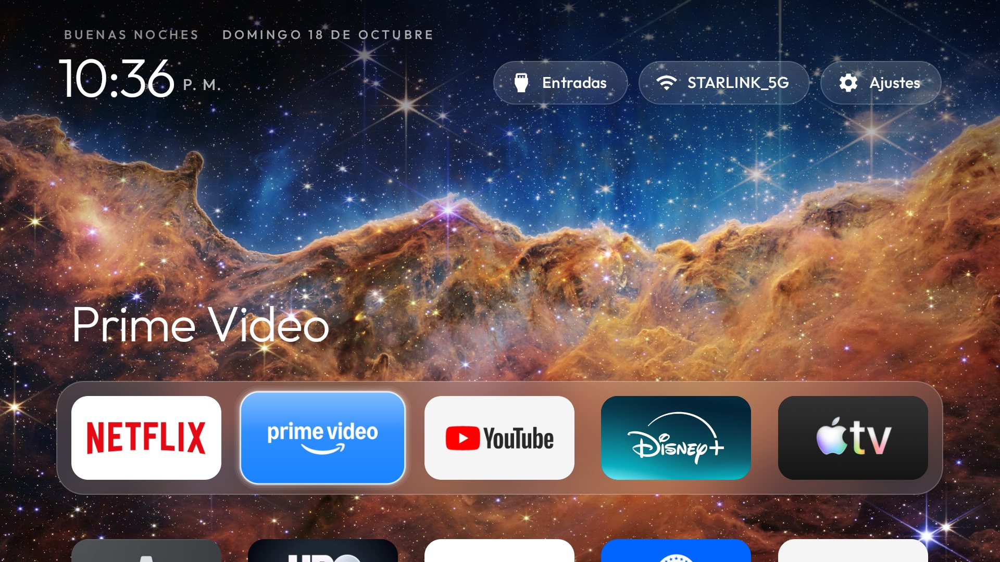

---

## Contenido

- [Capturas](#capturas)
- [Funciones](#funciones)
- [Fondos de pantalla](#fondos-de-pantalla)
- [Compilar e instalar](#compilar-e-instalar)
- [Quitar el bloatware](#quitar-el-bloatware)
- [Estructura del código](#estructura-del-código)
- [Notas](#notas)
- [Créditos y licencia](#créditos-y-licencia)

---

## Capturas

Todas las pantallas del launcher, tomadas en la TV con `adb shell screencap`.

<table>
  <tr>
    <td width="50%" valign="top"><br><b>Inicio</b><br><sub>Dock de 6 columnas sobre el fondo, con el nombre de la app enfocada.</sub></td>
    <td width="50%" valign="top">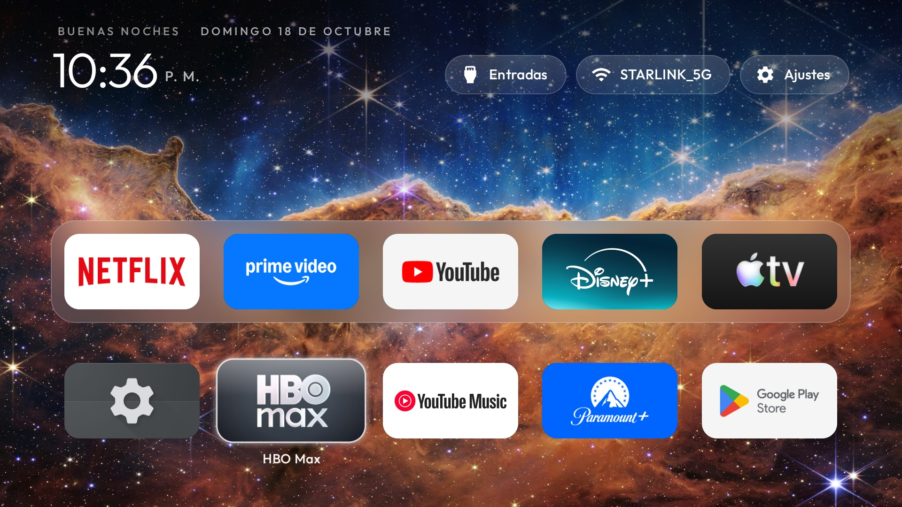<br><b>Cuadrícula</b><br><sub>Al bajar, las apps se desvanecen bajo la barra superior.</sub></td>
  </tr>
  <tr>
    <td width="50%" valign="top">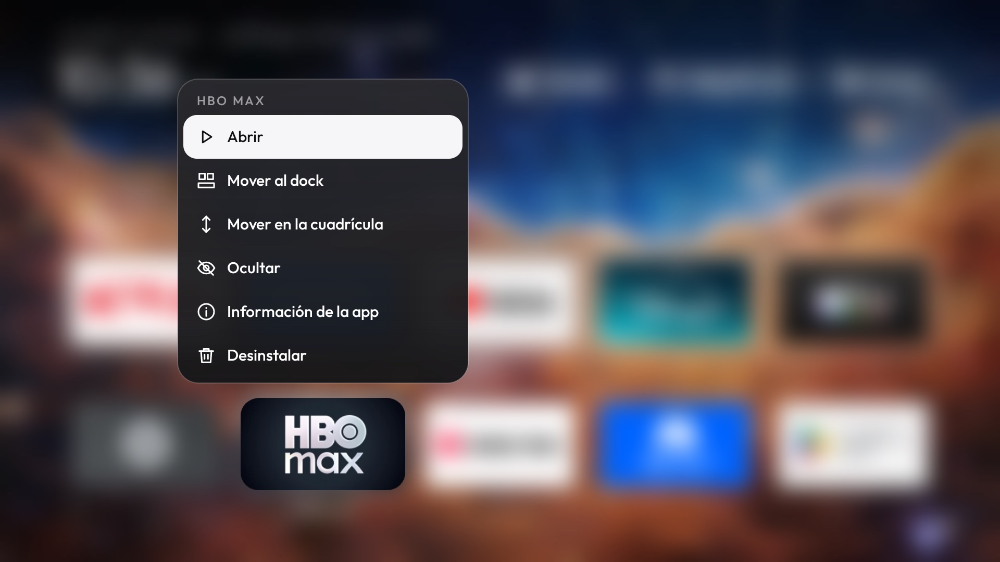<br><b>Menú de una app</b><br><sub>Desplegable junto a la app; el resto se desenfoca.</sub></td>
    <td width="50%" valign="top">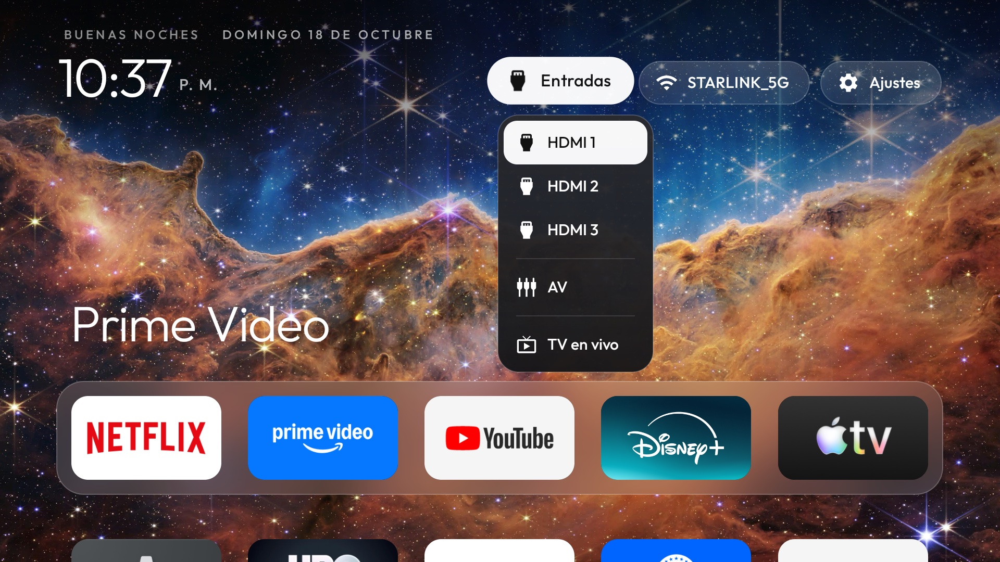<br><b>Entradas</b><br><sub>HDMI, AV y TV en vivo.</sub></td>
  </tr>
  <tr>
    <td width="50%" valign="top">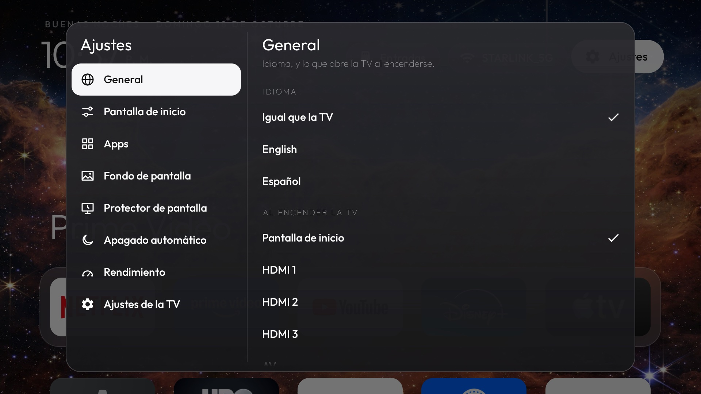<br><b>Ajustes · General</b><br><sub>Idioma y entrada al encender.</sub></td>
    <td width="50%" valign="top">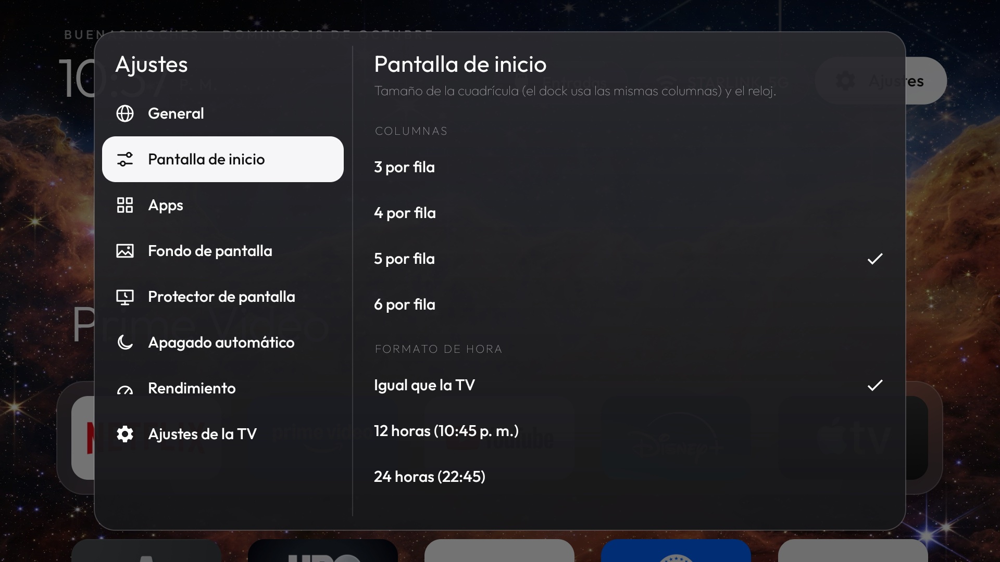<br><b>Ajustes · Pantalla de inicio</b><br><sub>Columnas y formato de hora.</sub></td>
  </tr>
  <tr>
    <td width="50%" valign="top">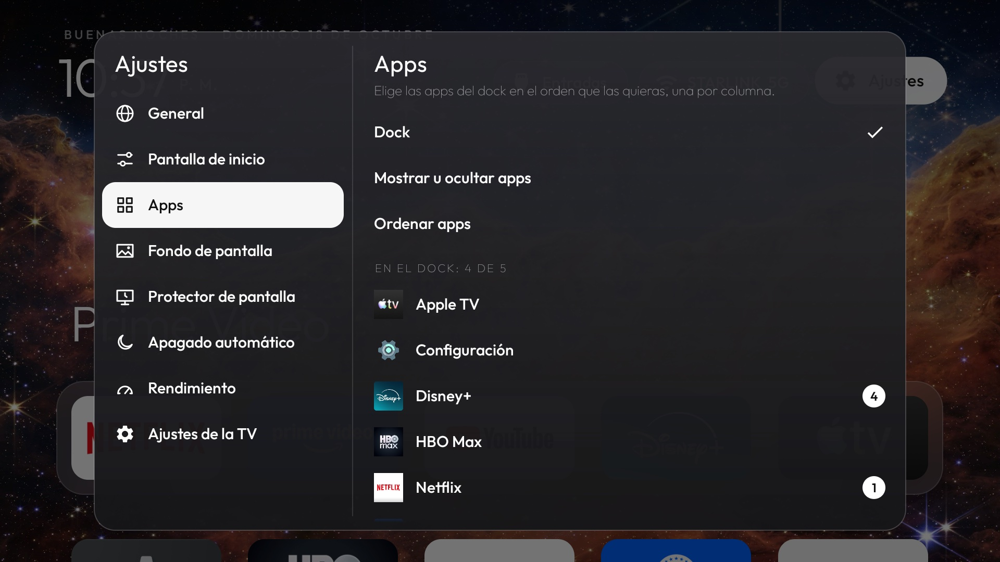<br><b>Ajustes · Apps · Dock</b><br><sub>Apps del dock y su orden.</sub></td>
    <td width="50%" valign="top">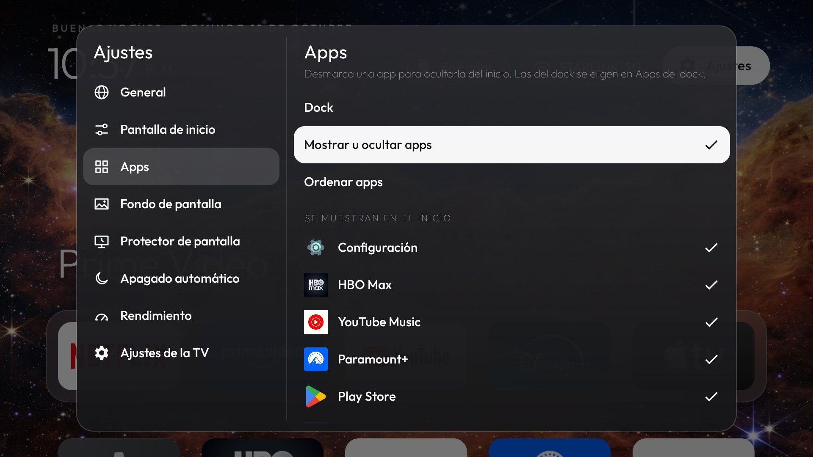<br><b>Ajustes · Apps · Mostrar u ocultar</b><br><sub>Desmarca una app para ocultarla.</sub></td>
  </tr>
  <tr>
    <td width="50%" valign="top">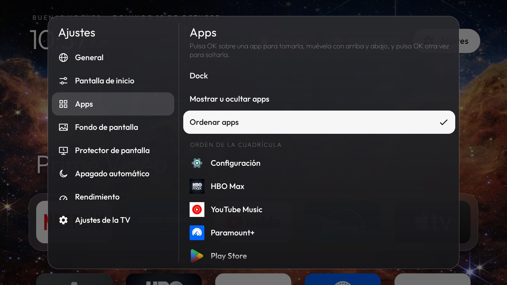<br><b>Ajustes · Apps · Ordenar</b><br><sub>Toma una app con OK y muévela.</sub></td>
    <td width="50%" valign="top">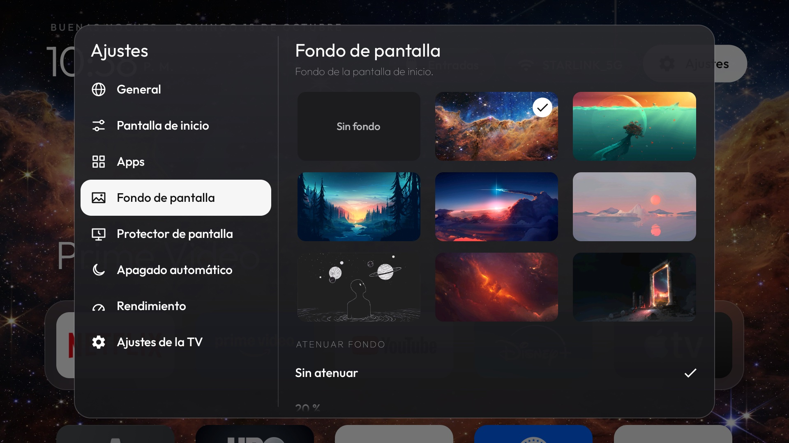<br><b>Ajustes · Fondo de pantalla</b><br><sub>Galería de fondos.</sub></td>
  </tr>
  <tr>
    <td width="50%" valign="top">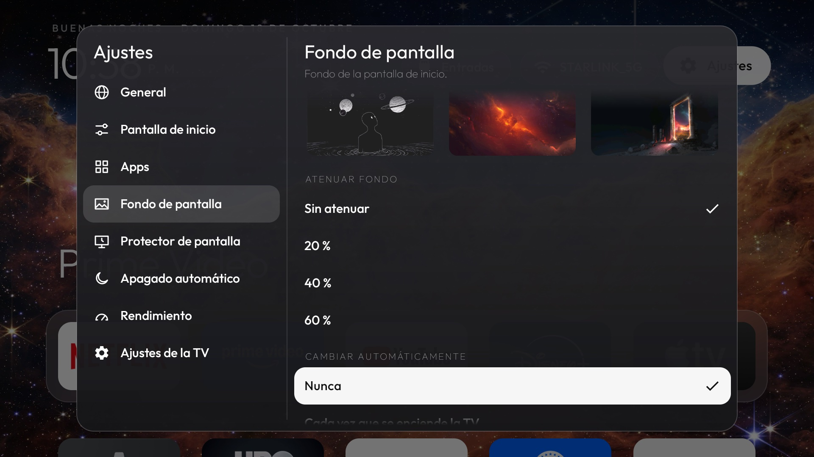<br><b>Ajustes · Fondo · Opciones</b><br><sub>Cambio automático.</sub></td>
    <td width="50%" valign="top">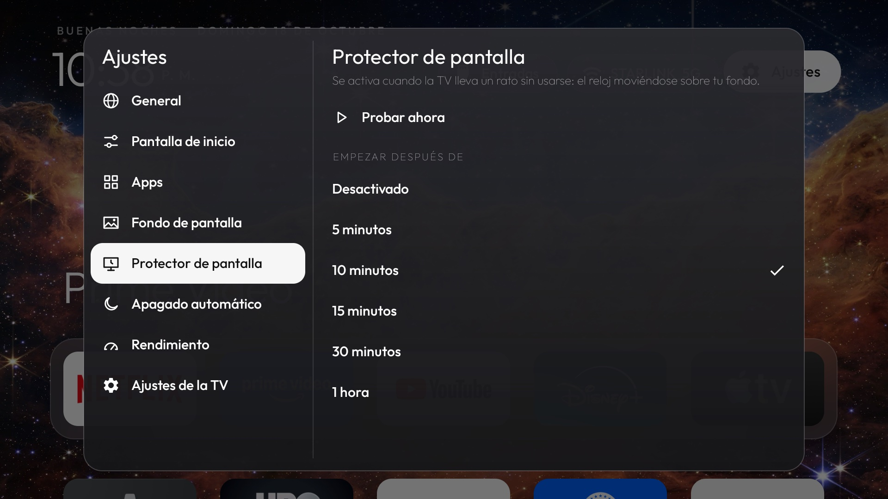<br><b>Ajustes · Protector de pantalla</b><br><sub>Tiempo de espera y Probar ahora.</sub></td>
  </tr>
  <tr>
    <td width="50%" valign="top">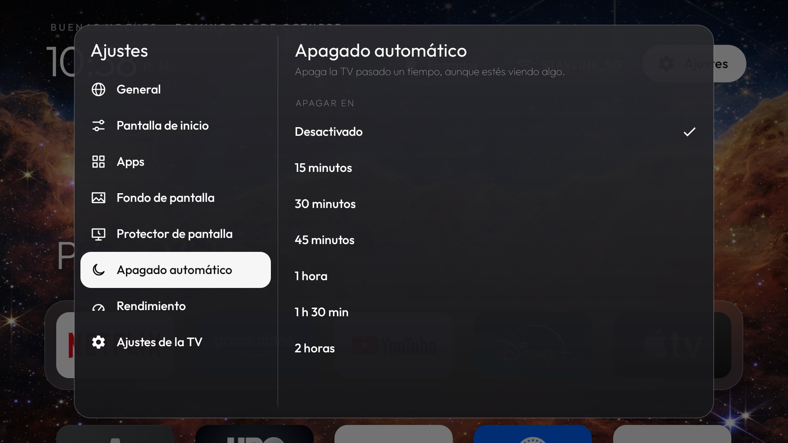<br><b>Ajustes · Apagado automático</b><br><sub>Apaga la TV pasado un tiempo.</sub></td>
    <td width="50%" valign="top">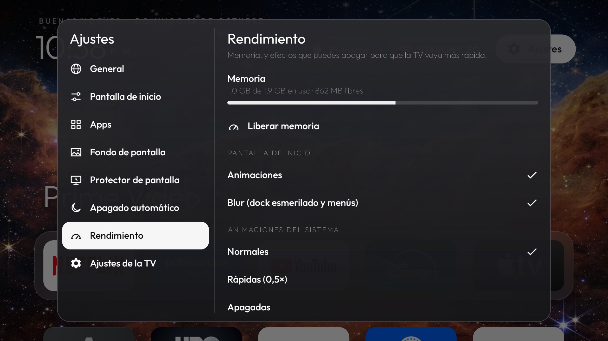<br><b>Ajustes · Rendimiento</b><br><sub>Memoria, animaciones y blur.</sub></td>
  </tr>
  <tr>
    <td width="50%" valign="top">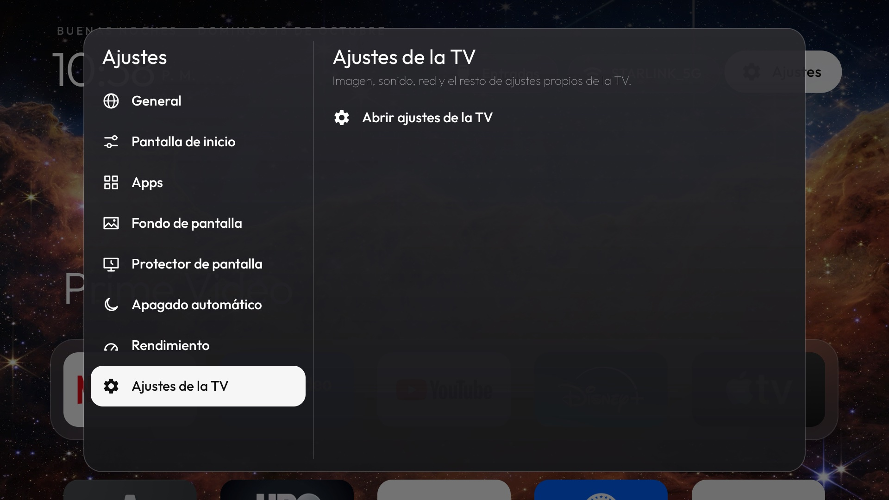<br><b>Ajustes · Ajustes de la TV</b><br><sub>Acceso a los ajustes de Android.</sub></td>
    <td width="50%" valign="top">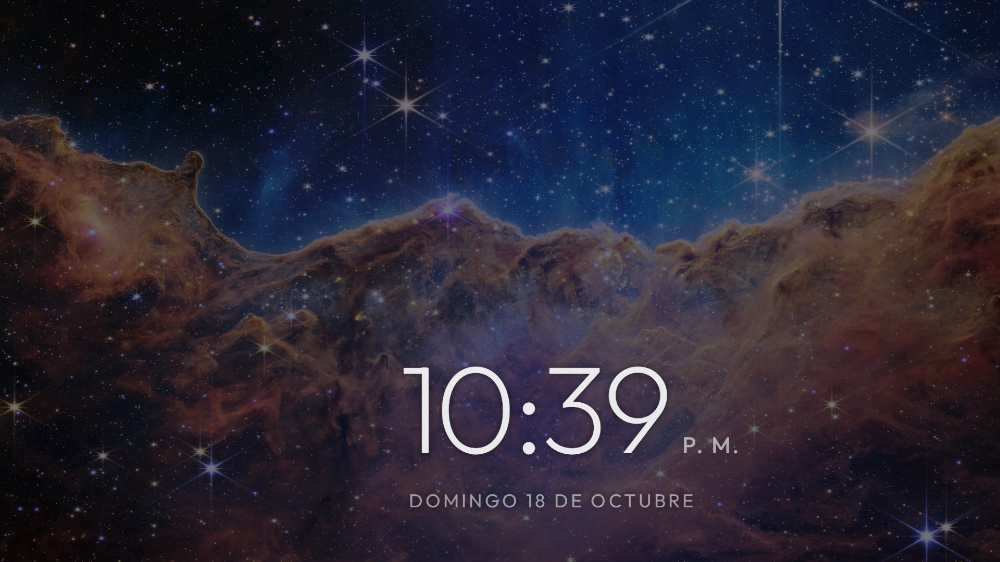<br><b>Protector de pantalla</b><br><sub>El reloj sobre el fondo, oscurecido.</sub></td>
  </tr>
</table>

## Funciones

### Ajustes

El botón de **Ajustes** (el engranaje de la barra superior) abre los ajustes a pantalla completa sobre el fondo de
pantalla: las secciones a la izquierda y, a la derecha, las opciones de la sección enfocada. Derecha entra
en las opciones; Izquierda o Atrás vuelven a las secciones. En **Fondo de pantalla**, al moverte por la
fila de fondos cada uno se ve detrás de los ajustes; OK lo usa, y si sales sin OK vuelve el actual.

| Sección | Qué hace |
|---|---|
| **General** | Idioma (inglés, español o el de la TV) y **entrada al encender**: pantalla de inicio, cualquier HDMI/AV o TV en vivo, con "Probar ahora". |
| **Pantalla de inicio** | Columnas (3, 4, 5 o 6): los iconos cambian de tamaño y el dock usa las mismas columnas. **Formato de hora**: como la TV, 12 o 24 horas (también en el protector). |
| **Apps** | Tres modos: **Dock** (elige sus apps y su orden, una por columna), **Mostrar u ocultar** y **Ordenar** (toma una app con OK, muévela con arriba/abajo y suéltala con OK o Atrás). |
| **Fondo de pantalla** | Una fila con los fondos incluidos, que se previsualizan detrás de los ajustes; OK elige. **Cambiar automáticamente**: cada vez que se enciende la TV, cada hora o cada día. |
| **Protector de pantalla** | Empezar después de 5, 10, 15, 30 minutos o 1 hora, o desactivado. **Probar ahora** lo muestra al momento. |
| **Apagado automático** | Apaga la TV en 15, 30, 45 minutos, 1 h, 1 h 30 o 2 h, aunque estés viendo algo. Avisa un minuto antes, y la hora de apagado se ve junto al reloj mientras está en marcha. |
| **Rendimiento** | Memoria en uso con barra, **Liberar memoria**, animaciones del launcher, blur y velocidad de las animaciones del sistema. |
| **Ajustes de la TV** | Abre los ajustes de Android (imagen, sonido, red…). |

Los ajustes se guardan en `SharedPreferences` y sobreviven a reinicios. Los valores por defecto
(dock inicial, apps ocultas, app de TV en vivo, columnas) están en
[`config.xml`](launcher/app/src/main/res/values/config.xml).

### Menú al mantener pulsada una app

Mantén pulsado OK sobre cualquier app. Aparece un desplegable junto a ella, con el mismo estilo que
el menú de Entradas (debajo de la app, o encima si no cabe). El resto del inicio se desenfoca y la app
pulsada queda nítida. Opciones:
**Abrir**, **Mover al dock** / **Quitar del dock**, **Mover en la cuadrícula** (abre Ajustes → Apps con
la app ya tomada), **Ocultar**, **Información de la app** y **Desinstalar** (solo en apps que no son
del sistema). Si el dock está lleno, la app nueva ocupa el último lugar.

### Protector de pantalla

El reloj del launcher se mueve despacio sobre tu fondo de pantalla oscurecido. Cambia de sitio cada minuto para no marcar el panel. Se activa con el sistema
de Android, así que también funciona fuera del launcher. "Desactivado" solo quita el protector; el
temporizador de apagado de la TV no cambia.

### Pantalla de inicio

- **Saludo y fecha** en la línea pequeña de arriba ("BUENAS NOCHES · DOMINGO 18 DE OCTUBRE"), para
  que la hora tenga su fila y las fechas largas no choquen con los botones. De 19 a 22 h dice "Buenas
  noches".
- **Desvanecido superior.** Al bajar a la cuadrícula, las apps se desvanecen bajo la barra de la hora
  y los botones en vez de cortarse de golpe, y la barra lleva un degradado oscuro sobre el fondo.
- **Siempre hay fondo de pantalla.** Si el elegido ya no está, se usa el primero de la lista.
- **Botones superiores con animación.** Al enfocarlos crecen desde el centro con un rebote suave; al
  pulsarlos se hunden y rebotan antes de abrir. Ajustes y el Centro de control son solo un icono.

### Centro de control

El botón de los dos interruptores, junto a Ajustes, abre un panel como el de tvOS sobre el inicio
desenfocado: la hora y la fecha; una fila de **interruptores** que se encienden y apagan con OK (azul =
encendido): **Wi‑Fi**, **Bluetooth**, **Silencio** y **Protector de pantalla**; y cuatro accesos: **Apagar**
(reposo ahora), **Apagado automático** (cada OK pasa a la siguiente duración: 15 min, 30 min… y
Desactivado), **Liberar memoria** (con la memoria libre) y **Ajustes de la TV**.

- Apagar y el apagado automático necesitan el administrador del dispositivo, y el interruptor del
  protector el permiso `WRITE_SECURE_SETTINGS`; los dos los da `deploy.sh`.
- Para poder encender y apagar el Wi‑Fi, el launcher usa `targetSdk 28`: desde Android 10, las apps que
  apuntan a 29 o más ya no pueden hacerlo.

### Vidrio esmerilado

Con **Rendimiento → Blur** encendido, todo usa el vidrio del dock: los botones de la barra superior, los
desplegables (Entradas, Wi‑Fi, el menú de una app), el Centro de control y las filas de los ajustes muestran
detrás el fondo desenfocado con un velo translúcido. Con el blur apagado vuelven a ser sólidos.

## Fondos de pantalla

Los fondos van dentro de la app, en
[`launcher/app/src/main/assets/wallpapers/`](launcher/app/src/main/assets/wallpapers/). Vienen 8:
Acantilados estelares, Bajo el mar, Bosque al atardecer, Cometa sobre las nubes, Icebergs al
atardecer, Mirando los planetas, Nebulosa roja y Portal en ruinas.

- Formatos: `.jpg`, `.jpeg`, `.png` o `.webp`.
- Usa 1920 px de ancho. Con macOS puedes convertir cualquier imagen así:

  ```bash
  sips -s format jpeg -s formatOptions 85 --resampleWidth 1920 original.png --out launcher/app/src/main/assets/wallpapers/mi_fondo.jpg
  ```

- Después de añadir o quitar imágenes, vuelve a desplegar.

## Compilar e instalar

Requisitos en macOS (Homebrew):

```bash
brew install openjdk@17 android-commandlinetools android-platform-tools
```

```bash
sdkmanager "platforms;android-34" "build-tools;34.0.0"
```

Activa la **depuración de red** en la TV (Opciones de desarrollador). Después, un solo comando compila,
instala, da los permisos y deja el launcher como inicio:

```bash
./scripts/deploy.sh 192.168.1.198
```

[`scripts/deploy.sh`](scripts/deploy.sh) hace esto:

1. Compila la versión **release**: firmada con tu clave y optimizada con R8, más pequeña y rápida.
   Sin clave, compila la versión debug. Para forzar debug, añade `--debug`.
2. Instala el APK por Wi-Fi. Si la firma cambió (de debug a release), desinstala la anterior primero;
   en ese caso los ajustes del launcher vuelven a los valores por defecto.
3. Da los permisos que la TV no deja dar desde sus menús: ubicación (para leer el nombre del Wi-Fi),
   `WRITE_SECURE_SETTINGS` y `WRITE_SETTINGS` (protector de pantalla y animaciones del sistema),
   `SYSTEM_ALERT_WINDOW` (abrir la entrada al encender) y **administrador del dispositivo** (el
   apagado automático: Android solo deja apagar la pantalla a un administrador).
4. Lo pone como pantalla de inicio.

### Clave de firma

La versión release se firma con una clave propia: `launcher/release.jks`, con sus contraseñas en
`launcher/keystore.properties`. **Ninguno de los dos va en git.** Guárdalos en un lugar seguro: sin la
misma clave no se puede actualizar el launcher encima, hay que desinstalarlo y se pierden los ajustes.

Para crear una clave nueva:

```bash
keytool -genkeypair -keystore launcher/release.jks -alias tvhome -keyalg RSA -keysize 2048 -validity 10000
```

Y `launcher/keystore.properties`:

```properties
storeFile=release.jks
storePassword=TU_CONTRASEÑA
keyAlias=tvhome
keyPassword=TU_CONTRASEÑA
```

### Desinstalar el launcher

Por el apagado automático, el launcher es administrador del dispositivo, y Android no deja desinstalar
un administrador activo. Antes de desinstalarlo, desactívalo en **Ajustes de la TV → Seguridad →
Administradores de dispositivos**.

## Quitar el bloatware

[`scripts/limpiar-mitv.sh`](scripts/limpiar-mitv.sh) quita para el usuario 0
(`pm uninstall -k --user 0`) los paquetes de la lista: telemetría de Xiaomi y Google, filas de
anuncios y recomendaciones, apps preinstaladas, casting, textos legales, protector de pantalla de
Google, autoinstalación, actualizaciones de firmware, búsqueda por voz y los launchers de fábrica.
También pone las animaciones del sistema a 0.5 y deja este launcher como inicio. Antes de quitar los
launchers de fábrica comprueba que este esté instalado.

```bash
./scripts/limpiar-mitv.sh 192.168.1.198
```

Para recuperarlo todo:

```bash
./scripts/limpiar-mitv.sh 192.168.1.198 --restaurar
```

No hace falta root ni se borra nada de la partición del sistema. Un restablecimiento de fábrica también
devuelve todas las apps. La lista está pensada para la MiTV_MOOR6; revísala antes de usarla en otro
modelo.

> **Ojo:** la lista quita la búsqueda por voz (`com.google.android.katniss`) y las actualizaciones
> de firmware (`com.xiaomi.mitv.updateservice`). Quita esas líneas del script si las quieres conservar.

## Estructura del código

| Archivo | Qué hace |
|---|---|
| [`MainActivity.java`](launcher/app/src/main/java/com/gathin/tvhome/MainActivity.java) | Pantalla de inicio: barra superior, fondo, columnas, navegación y fondo desenfocado de los menús. |
| [`AppAdapter.java`](launcher/app/src/main/java/com/gathin/tvhome/AppAdapter.java) | Lista de apps: el dock (una app por columna), la cuadrícula con columnas variables, apps ocultas y orden propio. |
| [`AppMenu.java`](launcher/app/src/main/java/com/gathin/tvhome/AppMenu.java) | Desplegable al mantener pulsada una app. |
| [`ControlCenter.java`](launcher/app/src/main/java/com/gathin/tvhome/ControlCenter.java) | El Centro de control: la hora, los interruptores y los accesos rápidos. |
| [`Frost.java`](launcher/app/src/main/java/com/gathin/tvhome/Frost.java) | El vidrio esmerilado del dock para cualquier vista: botones, desplegables y filas de ajustes. |
| [`SettingsDialog.java`](launcher/app/src/main/java/com/gathin/tvhome/SettingsDialog.java) | Los ajustes a pantalla completa, sus 8 secciones y la fila de fondos con vista previa. |
| [`Prefs.java`](launcher/app/src/main/java/com/gathin/tvhome/Prefs.java) | Ajustes guardados e idioma de la app. |
| [`SystemTweaks.java`](launcher/app/src/main/java/com/gathin/tvhome/SystemTweaks.java) | Protector de pantalla, animaciones del sistema y memoria. |
| [`SleepTimer.java`](launcher/app/src/main/java/com/gathin/tvhome/SleepTimer.java) | Apagado automático: alarmas, aviso previo y el administrador que apaga la pantalla. |
| [`TvHomeApp.java`](launcher/app/src/main/java/com/gathin/tvhome/TvHomeApp.java) | Detecta el encendido de la TV para la entrada al encender y el cambio de fondo. |
| [`Inputs.java`](launcher/app/src/main/java/com/gathin/tvhome/Inputs.java) | Entradas de la TV (HDMI, AV, TV en vivo) y cómo abrirlas. |
| [`Clocks.java`](launcher/app/src/main/java/com/gathin/tvhome/Clocks.java) | Formato de 12 o 24 horas para los relojes. |
| [`ClockScene.java`](launcher/app/src/main/java/com/gathin/tvhome/ClockScene.java) | La escena del protector, compartida por [`ClockDream`](launcher/app/src/main/java/com/gathin/tvhome/ClockDream.java) (el del sistema) y [`ScreensaverActivity`](launcher/app/src/main/java/com/gathin/tvhome/ScreensaverActivity.java) (Probar ahora). |
| [`Blur.java`](launcher/app/src/main/java/com/gathin/tvhome/Blur.java) | Blur por software: captura desenfocada del inicio y copias suaves del fondo. |
| [`Wallpapers.java`](launcher/app/src/main/java/com/gathin/tvhome/Wallpapers.java) | Lista, carga y miniaturas de los fondos. |
| [`DockDecoration.java`](launcher/app/src/main/java/com/gathin/tvhome/DockDecoration.java) | Banda del dock: sólida o esmerilada con el fondo desenfocado. |
| [`FadeFrame.java`](launcher/app/src/main/java/com/gathin/tvhome/FadeFrame.java) | Desvanece la cuadrícula en su borde superior. |
| [`Motion.java`](launcher/app/src/main/java/com/gathin/tvhome/Motion.java) | Interruptor de las animaciones del launcher. |

Los textos están en `res/values/strings.xml` (inglés) y `res/values-es/strings.xml` (español).

## Notas

- **El blur es por software.** El blur nativo de Android (`RenderEffect`) necesita Android 12 y esta
  TV tiene Android 11. El launcher desenfoca copias pequeñas (6 a 12 veces más chicas) y las escala:
  el fondo del dock se calcula una vez por fondo de pantalla, y el del menú en cada pulsación larga.
  Con el blur apagado, el dock es sólido y el menú solo oscurece el fondo.
- **Memoria.** El fondo se carga en RGB_565 y a 1920 px. "Liberar memoria" pide a Android que cierre
  los procesos en segundo plano de las demás apps; no toca los procesos persistentes del sistema.
- El launcher sigue sin permiso de Internet.

## Créditos y licencia

Basado en [tv-vibehack](https://github.com/Gathin23/tv-vibehack) de Gathin. MIT, ver
[`LICENSE`](LICENSE). La tipografía Outfit usa la SIL Open Font License, ver
[`launcher/FONT-LICENSE-OFL.txt`](launcher/FONT-LICENSE-OFL.txt). Los fondos de pantalla incluidos
son de sus autores; revisa sus licencias antes de publicar el APK o el repositorio.
