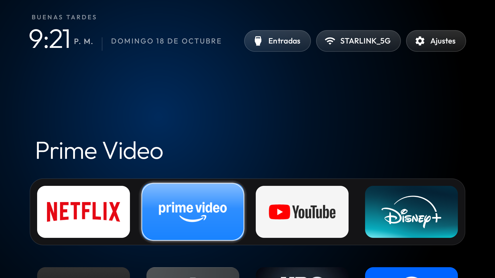
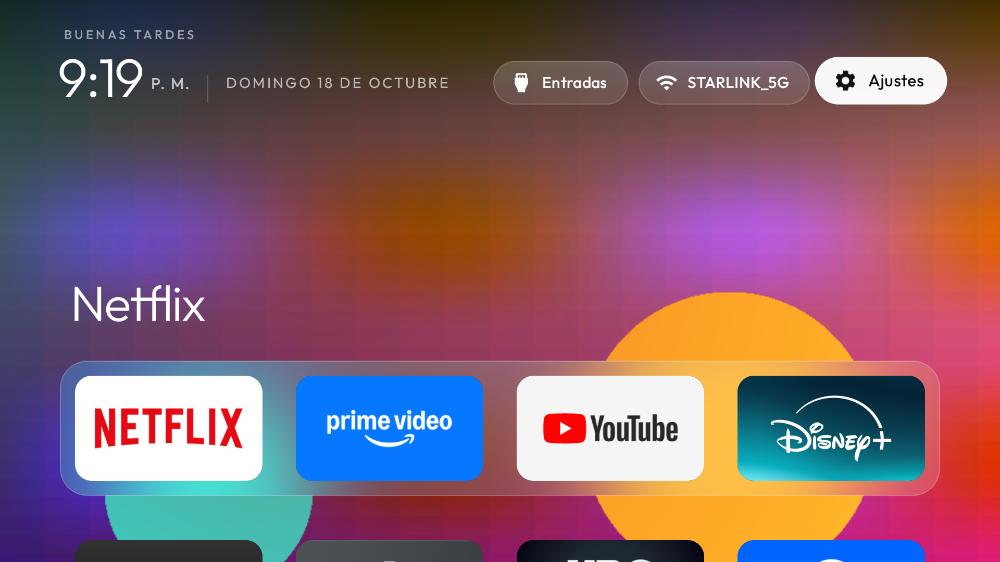
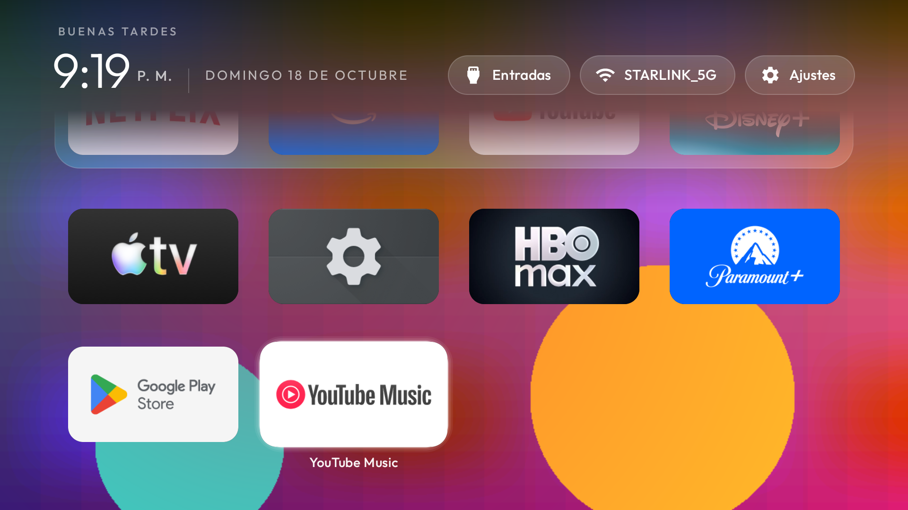
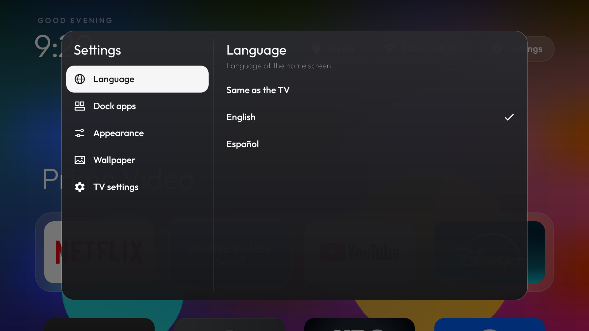

# tv-vibehack · Mi TV sin anuncios

Launcher ligero tipo Apple TV para Android TV, con ajustes propios, y un script para quitar el
bloatware por adb. Está probado en una **Xiaomi Mi TV (MiTV_MOOR6, Android TV 11, 1,8 GB de RAM)**.

Es un fork de [Gathin23/tv-vibehack](https://github.com/Gathin23/tv-vibehack). El README original
(en inglés, con el método completo de debloat para otras marcas) está en
[`docs/README-original.md`](docs/README-original.md).



---

## Contenido

- [Capturas](#capturas)
- [Qué añade este fork](#qué-añade-este-fork)
- [Fondos de pantalla](#fondos-de-pantalla)
- [Compilar e instalar](#compilar-e-instalar)
- [Quitar el bloatware](#quitar-el-bloatware)
- [Estructura del código](#estructura-del-código)
- [Notas](#notas)
- [Créditos y licencia](#créditos-y-licencia)

---

## Capturas

Capturas tomadas en la TV con `adb shell screencap`. El fondo multicolor es una imagen de prueba
generada para comprobar el blur; no se incluye en la app.

| Inicio | Fondo de pantalla + dock con blur |
|---|---|
|  |  |

| Cuadrícula con desvanecido superior | Ajustes: apps del dock |
|---|---|
|  |  |

| Ajustes: fondo de pantalla | Ajustes en inglés |
|---|---|
|  |  |

## Qué añade este fork

Todo se configura desde el botón **Ajustes** de la barra superior, que abre un modal con barra
lateral y el mismo estilo de vidrio que el menú de Entradas.

| Sección | Qué hace |
|---|---|
| **Idioma** | Inglés, español, o el idioma de la TV. Cambia textos, saludo y fecha al momento. |
| **Apps del dock** | Elige hasta 4 apps y su orden (se numeran 1–4). Incluye "Restaurar apps predeterminadas". |
| **Apariencia** | El fondo del dock es **sólido** o **vidrio esmerilado (blur)**. |
| **Fondo de pantalla** | Elige un fondo incluido en la app, con miniatura, o **Ninguno** para el negro con brillo de color. |
| **Ajustes de la TV** | Abre los ajustes de Android (imagen, sonido, red…). |

Otros cambios en la pantalla de inicio:

- **Desvanecido superior.** Al bajar a la cuadrícula, las apps se desvanecen bajo la barra de la hora
  y los botones en vez de cortarse de golpe. Con fondo de pantalla, la barra lleva además un degradado
  oscuro que sube hacia la parte de arriba.
- **Brillo de color en todas las apps.** Antes solo las apps del dock teñían el fondo con su color;
  ahora también lo hacen las de la cuadrícula.
- **Botones superiores con animación.** Al enfocarlos se escalan y suben un poco con un rebote
  suave; al pulsarlos se hunden y rebotan antes de abrir.

Los ajustes se guardan en `SharedPreferences` y sobreviven a reinicios. Los valores por defecto
(dock inicial, apps ocultas, app de TV en vivo, columnas) siguen en
[`config.xml`](launcher/app/src/main/res/values/config.xml).

## Fondos de pantalla

Los fondos van dentro de la app, en:

```
launcher/app/src/main/assets/wallpapers/
```

- Formatos: `.jpg`, `.jpeg`, `.png` o `.webp`.
- El nombre del archivo es el título en los ajustes: `playa_azul-2.jpg` aparece como "Playa azul 2".
- Tamaño recomendado: 1920 × 1080. Si es más grande se reduce al cargarlo, para ahorrar memoria.
- Después de añadir o quitar imágenes, vuelve a compilar e instalar.

Sin imágenes en la carpeta, la sección muestra solo **Ninguno** y un aviso.

## Compilar e instalar

Requisitos en macOS (Homebrew):

```bash
brew install openjdk@17 android-commandlinetools android-platform-tools
```

```bash
sdkmanager "platforms;android-34" "build-tools;34.0.0"
```

Compilar el APK (desde la carpeta `launcher/`):

```bash
JAVA_HOME=/opt/homebrew/opt/openjdk@17 ANDROID_HOME=/opt/homebrew/share/android-commandlinetools ./gradlew assembleDebug
```

Activa la **depuración de red** en la TV (Opciones de desarrollador) y conéctate. Cambia la IP por la
de tu TV:

```bash
adb connect 192.168.1.198:5555
```

Instala el launcher:

```bash
adb install -r app/build/outputs/apk/debug/app-debug.apk
```

Dale el permiso para leer el nombre del Wi-Fi:

```bash
adb shell pm grant com.gathin.tvhome android.permission.ACCESS_FINE_LOCATION
```

Ponlo como pantalla de inicio:

```bash
adb shell cmd package set-home-activity --user 0 com.gathin.tvhome/.MainActivity
```

## Quitar el bloatware

[`scripts/limpiar-mitv.sh`](scripts/limpiar-mitv.sh) quita para el usuario 0
(`pm uninstall -k --user 0`) los paquetes de la lista: telemetría de Xiaomi y Google, filas de
anuncios y recomendaciones, apps preinstaladas, casting, textos legales, protector de pantalla,
autoinstalación, actualizaciones de firmware, búsqueda por voz y los launchers de fábrica. También pone
las animaciones del sistema a 0.5 y deja este launcher como inicio. Antes de quitar los launchers de
fábrica comprueba que este esté instalado.

```bash
./scripts/limpiar-mitv.sh 192.168.1.198
```

Para recuperarlo todo:

```bash
./scripts/limpiar-mitv.sh 192.168.1.198 --restaurar
```

No hace falta root ni se borra nada de la partición del sistema. Un restablecimiento de fábrica también
devuelve todas las apps. La lista está pensada para la MiTV_MOOR6; revísala antes de usarla en otro
modelo.

> **Ojo:** la lista quita la búsqueda por voz (`com.google.android.katniss`) y las actualizaciones
> de firmware (`com.xiaomi.mitv.updateservice`). Quita esas líneas del script si las quieres conservar.

## Estructura del código

| Archivo | Qué hace |
|---|---|
| [`MainActivity.java`](launcher/app/src/main/java/com/gathin/tvhome/MainActivity.java) | Pantalla de inicio, barra superior, brillo de color, fondo de pantalla y animación de los botones. |
| [`SettingsDialog.java`](launcher/app/src/main/java/com/gathin/tvhome/SettingsDialog.java) | El modal de ajustes con barra lateral y sus secciones. |
| [`Prefs.java`](launcher/app/src/main/java/com/gathin/tvhome/Prefs.java) | Ajustes guardados e idioma de la app. |
| [`Wallpapers.java`](launcher/app/src/main/java/com/gathin/tvhome/Wallpapers.java) | Lista, carga y miniaturas de los fondos, y el blur por software. |
| [`DockDecoration.java`](launcher/app/src/main/java/com/gathin/tvhome/DockDecoration.java) | Banda del dock: sólida o esmerilada con el fondo desenfocado. |
| [`FadeFrame.java`](launcher/app/src/main/java/com/gathin/tvhome/FadeFrame.java) | Desvanece la cuadrícula en su borde superior. |
| [`AppAdapter.java`](launcher/app/src/main/java/com/gathin/tvhome/AppAdapter.java) | Lista de apps; las 4 primeras son el dock. |

Los textos están en `res/values/strings.xml` (inglés) y `res/values-es/strings.xml` (español).

## Notas

- **El blur es por software.** El blur nativo de Android (`RenderEffect`) necesita Android 12 y esta
  TV tiene Android 11. El launcher desenfoca una copia pequeña del fondo una sola vez y la dibuja detrás
  del dock. Sin fondo de pantalla, el modo esmerilado es una banda translúcida que deja ver el brillo
  de color.
- **Memoria.** El fondo se carga en RGB_565 y la copia desenfocada es 12 veces más pequeña, para no
  pesar en TVs con poca RAM.
- El launcher sigue sin permiso de Internet.

## Créditos y licencia

Basado en [tv-vibehack](https://github.com/Gathin23/tv-vibehack) de Gathin. MIT, ver
[`LICENSE`](LICENSE). La tipografía Outfit usa la SIL Open Font License, ver
[`launcher/FONT-LICENSE-OFL.txt`](launcher/FONT-LICENSE-OFL.txt).
